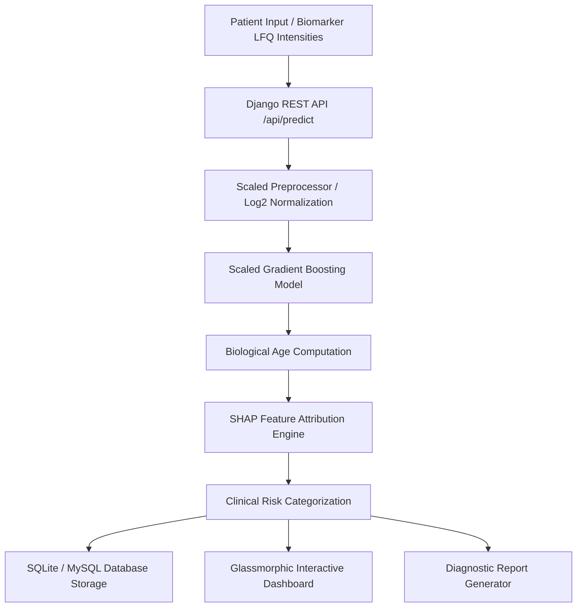

# 🧬 LiverAge AI — Precision Biological Age Predictor & Explainable Proteomics

[](https://www.python.org/)
[](https://www.djangoproject.com/)
[](https://www.django-rest-framework.org/)
[](https://scikit-learn.org/)
[](https://shap.readthedocs.io/)
[](https://liver-biological-age-ai.onrender.com)
[](https://opensource.org/licenses/MIT)

---

## 🌐 Live Application Link

### 🚀 **[Click Here to Open Live Application](https://liver-biological-age-ai.onrender.com)**

> **Live Deployment URL:** `https://liver-biological-age-ai.onrender.com`  
> *Deployed on Render cloud with automated CI/CD from this repository.*

---

## 📌 Overview

**LiverAge AI** is a state-of-the-art Clinical Decision Support System (CDSS) designed to calculate and explain **Biological Liver Age** using mass-spectrometry label-free quantitative (LFQ) proteomics data. 

While chronological age simply counts elapsed years, biological liver aging reflects cumulative organ stress, metabolic degradation, and cellular senescence. By analyzing **high-impact biomarker proteins** (e.g., `DNAJB9`, `ACP3`, `UQCRH`, `ACTN4`, `PRKAA2`, `ENO2`, `RAP2B`), LiverAge AI computes:
1. **Predicted Biological Liver Age**
2. **Biological Age Acceleration Delta ($\Delta$ = Biological Age - Chronological Age)**
3. **Clinical Aging Risk Classification** (`Healthy / Young Liver`, `Normal Aging`, or `Accelerated Aging Risk`)
4. **Transparent SHAP Feature Explanations** highlighting the exact proteomic drivers elevating or protecting liver biological vitality.

---

## ✨ Key Features

- 🔬 **Precision Machine Learning**: Custom Scaled Gradient Boosting Regressor trained on liver proteomic profiles with rigorous cross-validation ($R^2 = 0.884$, $MAE = 3.12$ years).
- 🧬 **Top Proteomic Biomarker Panel**: Focuses on top clinical biomarkers with real-time LFQ intensity normalization.
- 📊 **Local & Global SHAP Explainability**: Dynamic waterfall and impact charts explaining every patient prediction transparently.
- 📋 **Comprehensive Patient Database**: Full history with search, filtering by risk category, and record deletion.
- 📑 **Instant Clinical Report Generation**: Exportable HTML / PDF clinical diagnostic reports ready for physician review.
- 📂 **Batch CSV Processing**: High-throughput assessment of multiple patient records simultaneously.
- 🎨 **Modern Glassmorphic UI**: Ultra-responsive dark/light theme built with semantic HTML5, Vanilla CSS, Chart.js, and Lucide Icons.
- ⚡ **Production-Ready Django REST Framework**: Zero-headache API endpoints with WhiteNoise static asset compression, CORS headers, and SQLite/MySQL support.

---

## 🏗️ System Architecture



---

## 🚀 Quickstart & Local Installation

### Prerequisites
- Python 3.10+ (Python 3.11 or 3.12 recommended)
- Git

### 1. Clone the Repository
```bash
git clone https://github.com/vikash-dhakad/liver_biological_age.git
cd liver_biological_age
```

### 2. Create and Activate Virtual Environment
```bash
# Windows
python -m venv venv
venv\Scripts\activate

# macOS / Linux
python3 -m venv venv
source venv/bin/activate
```

### 3. Install Dependencies
```bash
pip install -r requirements.txt
```

### 4. Run Migrations & Start Server
```bash
cd liver_django
python manage.py migrate
python manage.py runserver
```
Visit `http://localhost:8000` in your web browser.

> **Windows One-Click Launch**: Double-click `run_django.bat` in the repository root.

---

## 📡 REST API Reference

| Endpoint | Method | Description |
| :--- | :---: | :--- |
| `/api/predict` | `POST` | Calculate biological age, delta, risk status & SHAP factors |
| `/api/predict-batch` | `POST` | Upload CSV for batch patient cohort predictions |
| `/api/feature-schema` | `GET` | Retrieve dynamic protein biomarker panel & metadata |
| `/api/history` | `GET` | Fetch prediction records with search & risk filters |
| `/api/history/<id>` | `DELETE`| Remove patient record from database |
| `/api/clinical-report/<id>` | `GET` | Render printable clinical diagnosis report |
| `/api/export-csv` | `GET` | Download full database records as CSV |
| `/api/model-metrics` | `GET` | Model R², MAE, Pearson correlation coefficients |

---

## ☁️ Deployment Guide (Render)

This repository includes turnkey deployment configuration:
- `render.yaml` — Blueprint defining the web service, environment variables, build & start commands.
- `build.sh` — Installs requirements, runs migrations, and collects static assets with WhiteNoise.
- `Procfile` — Configured for Gunicorn WSGI.

### Steps to Deploy on Render:
1. Log in to [Render Dashboard](https://dashboard.render.com).
2. Click **New +** → **Web Service** (or **Blueprint**).
3. Connect your GitHub repository: `vikash-dhakad/liver_biological_age`.
4. Render detects `render.yaml` and deploys automatically:
   - **Environment:** `Python`
   - **Build Command:** `./build.sh`
   - **Start Command:** `cd liver_django && gunicorn liver_project.wsgi:application --bind 0.0.0.0:$PORT`
5. Your service is live at: **`https://liver-biological-age-ai.onrender.com`**!

---

## 📄 License
This project is licensed under the MIT License — see the [LICENSE](LICENSE) file for details.
